# How the homepage design got made

October 22, 2026. One long session between Ian and Claude, from a plain two-door layout to the Alice-in-Wonderland prototype in `index.html`. This is the record of what we tried, what Ian said, what failed, and what we'd do again. The screenshots are in `process/`.

## The starting point

The site had copy (`.claude/wireframe-homepage.html`) and a two-door structure (SITE-CONCEPT.md), but no visual design. The method came from Anshu Chimala's guest post in Lenny's Newsletter, "How to turn your AI into a world-class designer" (Sep 2026). It lays out three stages, each with techniques:

- **Discover:** use random seed strings to break the model's defaults, and write ambitious prompts shaped by your own taste.
- **Define:** run a critic agent that judges screenshots only, and use generated images (and video) instead of gradients and boxes.
- **Deliver:** cut what doesn't earn its place, remove AI tells, and rewrite the copy by hand.

## Round 1: five concepts, one palette

Five agents each built one homepage from the same brief: a wall with openings, a government form ("Check one."), road signs at a fork, a risograph zine, and one direction picked by a random seed. All five used Ian's copy word for word.

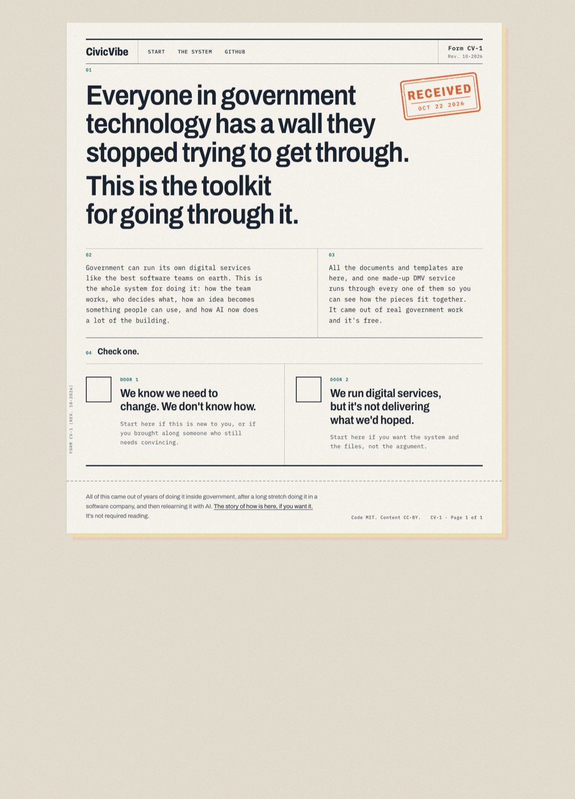
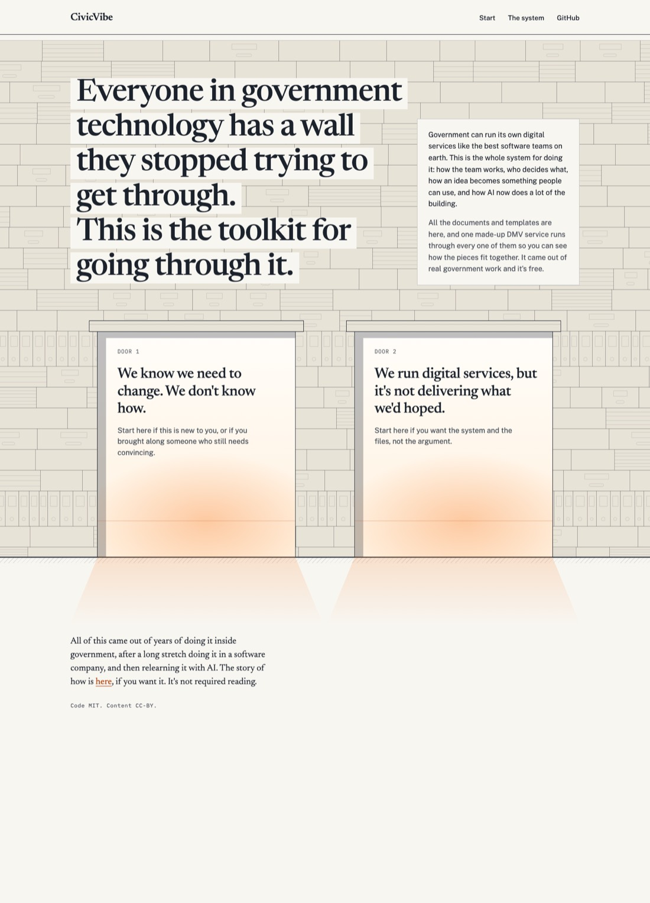

Ian: "color palette is super claude - did you generate that random string per the advice? how much of the advice did you end up following?"

He was right. All five landed on cream paper, slate, burnt orange and teal. The brief had named the brand colors, so every agent kept them. Only one of the five got a seed, and that agent read the seed's "28" as a hue of 28°, which is orange. Going down the article technique by technique, we had followed about two of the eight properly.

## Ian's taste, then round 2

Before rerunning, Claude asked Ian three questions:
- **Feel:** "civic and permanent" and "bold and loud".
- **Structure:** "let the seed decide".
- **Hard no:** skeuomorphic props (stamps, paper textures, fake objects).

Round 2 gave each agent its own random seed. A script, not the model, turned each seed into the palette, both fonts, the type scale and the grid (`_working/design/round2-specs.json`). The model only decided structure.

The first pass came back as five transit maps. The brief had described "civic and permanent" as "like a public library, a transit map, a great park sign", and every agent drew the example. With the examples removed and every earlier motif banned, the rerun produced five genuinely different pages.

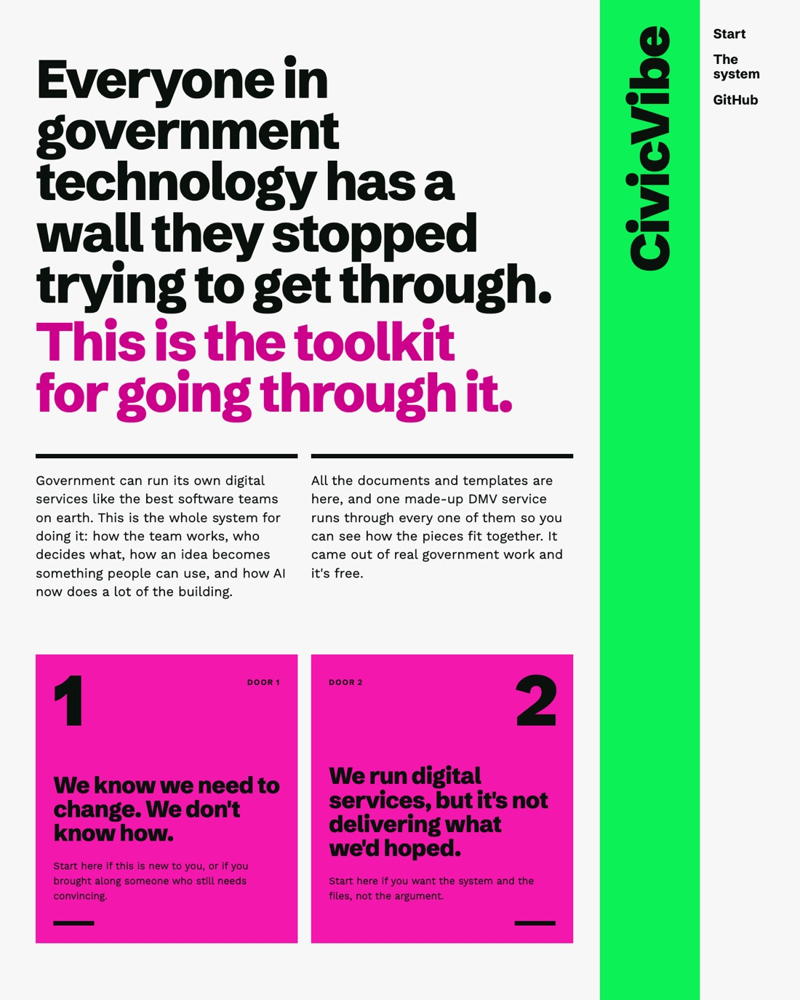
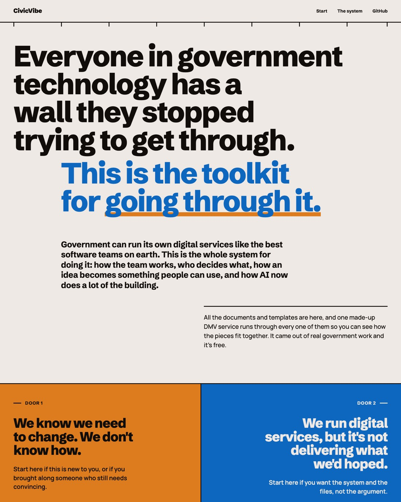

Ian picked seed 4: "still a bit boring but seed 4".

## The critic loop that stalled

Seed 4 went into the article's critic loop.
- **The critic:** a stronger model that sees only screenshots, gets the same prompt every round (`CRITIC-PROMPT.md`) and scores out of 10.
- **The builder:** revises from each critique.

The scores went 5, 5, 5.

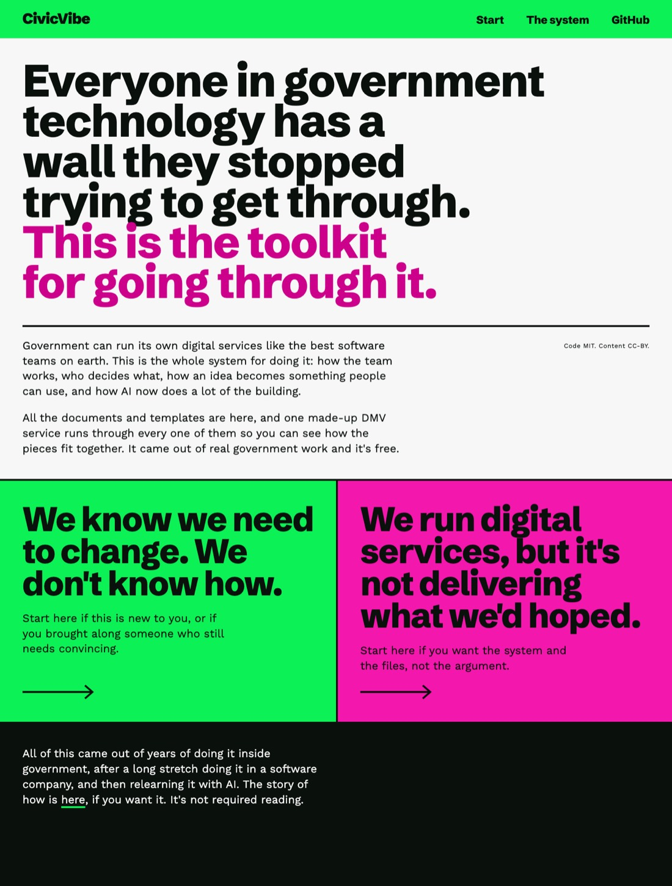

Two things went wrong:
- **The prompt was the article's "OK" version.** It asked the critic to imagine how a top studio would do it. Each fresh critic imagined a different studio, so the target moved every round.
- **Nobody caught the real problem.** Ian looked at the page and said "what 'doors' i don't see any doors." Three rounds of critique had polished two colored panels that didn't read as a choice.

## Images, references, and Ian's own words

Image generation was set up through Gemini, with the key kept in 1Password and passed in by `op run` (`.env.op`, `scripts/gen-image.mjs`). The first key had been revoked, so Ian made a new one. The first test image came back in the generic flat "corporate people" style, which is itself an AI tell, so it was used as the example of what to avoid.

Ian gave three reference sites:
- unreasonablehospitality.com
- crosswalk.cl
- dawnsaunders.com

What they share is a person in the frame, one idea per screen, scroll as the mechanic, one dominant color, and big shapes that mean something. The critic was rewritten to rank our page against those three sites without knowing which was ours (`CRITIC-PROMPT-v2.md`).

The next version put the doors in arches, with linocut portraits behind them and an "or" between them.

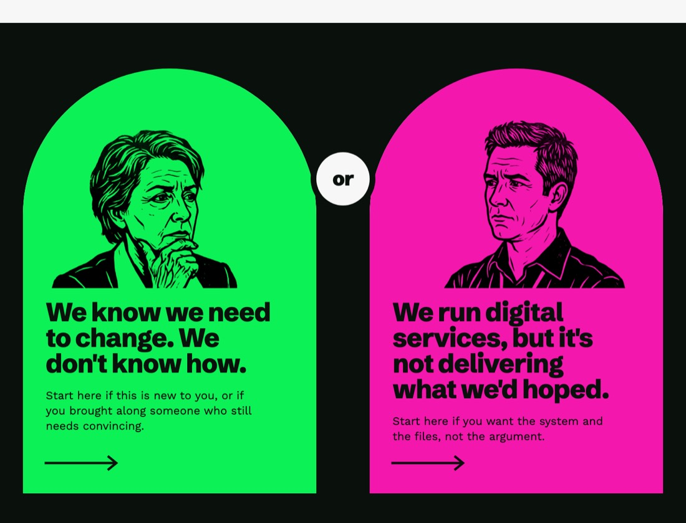

Then Ian rewrote the copy himself. The headline became "...I'm gonna help you smash a hole in the wall... oh yeah!", and the two intro sentences became four paragraphs in his own voice. His next notes:
- "you lost literally all of your design quality". The new paragraphs had been dropped in with no design.
- "the 'doors' like this doesn't visually read as doors to go through".
- "this is starting to make me think a bit about alice in wonderland as a motif, falling down the rabbit hole for a spectacular and unexpected journey in which you'll be changed when its over".

## Alice

The first Alice version had the headline at the edge of a rabbit hole, scrolling as the fall, and real doors with knobs and keyholes in a hall at the bottom.

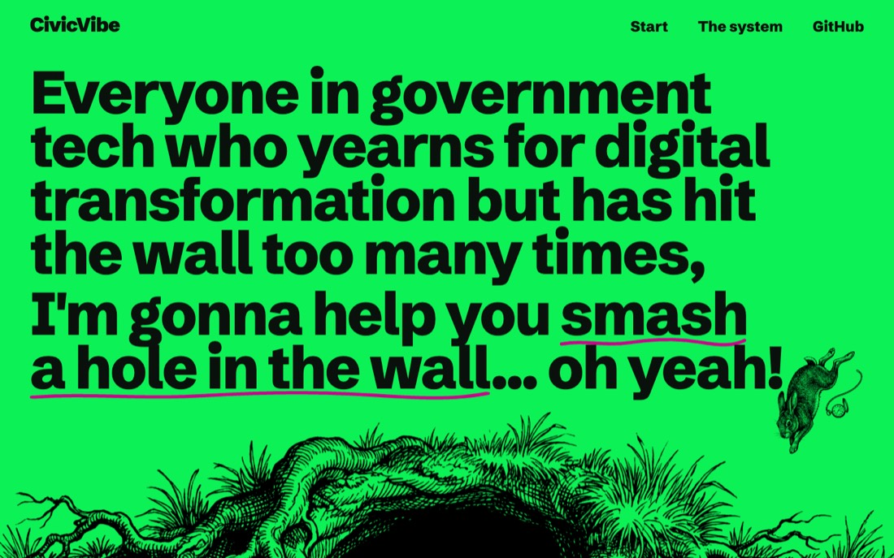
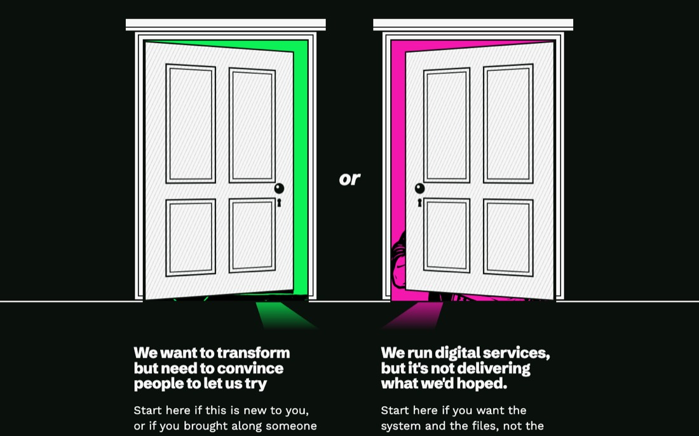

Ian: "this is the direction". The reference-ranking critic scored it 5/10, then 6, then 6, ranking it last of four sites each time. The critics also started contradicting each other. One said to put small doors in the hole on the first screen; the next said to take them out.

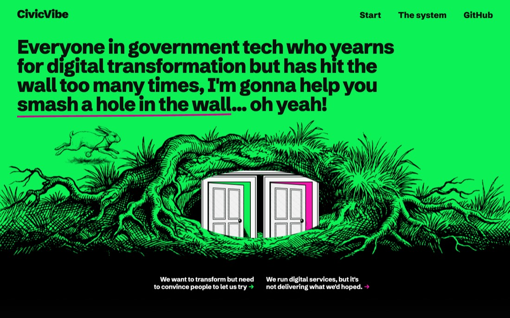

Ian broke the stall with a copy pass and a set of design notes.

**Copy:**
- The headline became "...I'm gonna help you make a door."
- The pull-quotes became short tags.
- Three phrases were swapped: wall → door, cliff → risk, sh*t → "under the mountain of bureaucracy".

**Design:**
- The door should grow out of the roots, open as you scroll, and take you through.
- The fall needs faint walls so you feel distance traveled.
- "don't worry about bringing the door in sooner... we are telling a story here". A small skip link is enough for people who want to jump ahead.
- The doors didn't match the style of the other images.
- "it doesn't make sense to have pictures of people behind the doors, it should portals into different worlds".
- "please don't just try and execute what I'm saying".

The book itself answered most of these:
- **Chapter 7:** Alice finds a tree with a door in it and goes through. That became the first screen.
- **Chapter 1:** the well's sides are lined with cupboards, bookshelves and maps on pegs. Those became the passage walls.
- **The garden:** through the tiny door Alice sees "the loveliest garden you ever saw" and can't yet reach it. That's door 1 exactly, for people who want this and need permission. Door 2 got a working clockwork world with an oil can and wrench left out, ready to be tuned.

All the art was regenerated as engravings in Tenniel's 1865 style.

## The scare, and the fix

The rebuild went to a fresh builder agent with a long list of changes. Ian: "this is much worse on a quality level".

Some of that was real: the layout had lost judgment the previous builder had built up over four rounds. But most of it was something else. Ian was looking in the app's built-in browser, which opens a local file as a snapshot and drops every image. Served from localhost with the images loading, his verdict was "this is pretty fucking slick".

The rest was done one stage at a time, with Ian's yes before each next stage:
1. **The door in the tree.** The headline overlapped the trunk at mid widths. The White Rabbit was green on green, so it got its white coat back. The headline faded before the door got close.
2. **The passage.** The shaft became the grid: tags hang off alternating walls, and the paragraphs share one reading column. The walls became crisp engraved lines instead of green haze.
3. **The hall.** It became a lit paper room, so the lights come on at the bottom of the fall. The doors print in ink and stand open on their worlds, with the text under each door.

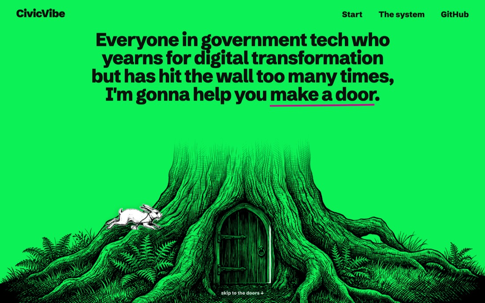

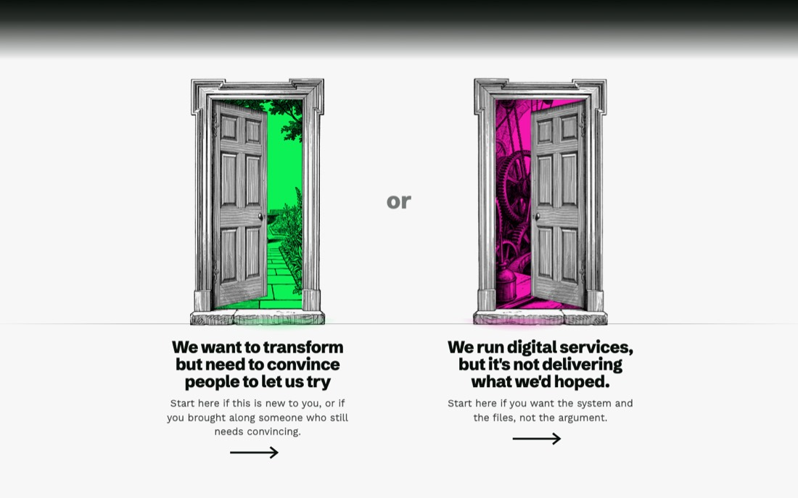

## What we'd do again, and what we wouldn't

- **The brief is where sameness comes from.** Naming brand colors gave five identical palettes. Giving "transit map" as an example of "civic" gave five transit maps. Describe the feeling, never an example of it.
- **Get randomness from outside the model.** A seed the model interprets drifts back to its defaults. A script that turns the seed into hex values and font names doesn't.
- **A critic needs a fixed bar.** "Imagine a top studio" never converged. Ranking against real reference sites was better, but it still stalled around 6/10. Every stall was broken by Ian's taste, not by another round.
- **The model adds; the person decides.** The decisive notes were Ian's: "boring", "what doors?", "lost all design quality", the Alice motif, "portals, not people".
- **Don't hand a fresh agent a long checklist.** It executes the list and loses the judgment. Small stages, each reviewed on screen before the next, worked.
- **Check what the person is actually seeing.** One "much worse" was a browser dropping images.
- **The copy is Ian's.** Every design change after round 3 followed a copy change he made, not the other way round.

## Where things live

- **Prototype:** `design/homepage/index.html`, with its 18 engravings in `img/`. To view it, run `design-prototype` in `.claude/launch.json`, then open http://localhost:3060/.
- **Critic prompts:** `CRITIC-PROMPT.md` (the imagined-studio bar) and `CRITIC-PROMPT-v2.md` (ranking against references).
- **Image generation:** `scripts/gen-image.mjs`. The style suffix is in this folder's README.
- **The working trail:** every concept, round, backup, screenshot and reference capture is in `_working/design/`. That folder is gitignored and lives on Ian's machine only.
- **Next:** port to the Next.js homepage, test Safari, and check tablet widths. Tracked in GitHub issue #1.
